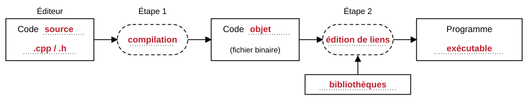

<!-- _class: lead -->
<!-- _paginate: false -->
<!-- _header: '' -->
<!-- _footer: '' -->

# C01 - Du code source au programme

## Informatique - Témoin du kit

1CIELIR - Lycée Louis Rascol, Albi

<!--
Ce deck est le pendant du COURS.md du témoin : même plan, même schéma (le même fichier).
-->

---

## Pourquoi apprendre le C++ ?

- Un langage **rapide**, **flexible** et **portable**
- Deux paradigmes : procédural et orienté objet
- Son prix : de la **rigueur**

| Date | Événement |
| --- | --- |
| 1979 | « C with Classes » |
| 1983 | Rebaptisé C++ |
| 2011 | Début du C++ moderne |

---

## Du code source au programme



---

## Premier programme

```cpp
#include <iostream>
using namespace std;

int main() {
    int age;
    cout << "Quel âge as-tu ? ";
    cin >> age;
    cout << "Tu as " << age << " ans." << endl;
    return 0;
}
```

> Une directive de préprocesseur ne se termine pas par un point-virgule.

---

<!-- _class: piege -->

## Compiler et exécuter

```text
$ g++ -Wall -o age age.cpp
$ ./age
Quel âge as-tu ? 17
Tu as 17 ans.
```

> `cin` laisse le retour à la ligne dans le tampon : une lecture de texte qui suit peut échouer.

---

## Crédits des images

| Image | Auteur | Licence | Source |
| --- | --- | --- | --- |
| Schéma de la chaîne de construction | Création originale du kit | — | ce dépôt |

---

<!-- _class: chapitre -->

# Les éléments de mise en page

*Ce que le témoin doit exercer*

---

## Deux colonnes, une figure, du texte menu

<div class="cols">

<div>

**À gauche** : du texte, pour vérifier que la grille tient.

- une liste
- deux éléments

</div>

<div>

<figure>

<figcaption>La chaîne de construction
<span class="credit">Création originale du kit</span></figcaption>
</figure>

</div>

</div>

<p class="petit">Texte menu : il sert aux notes de bas de slide, et doit rester lisible projeté.</p>
